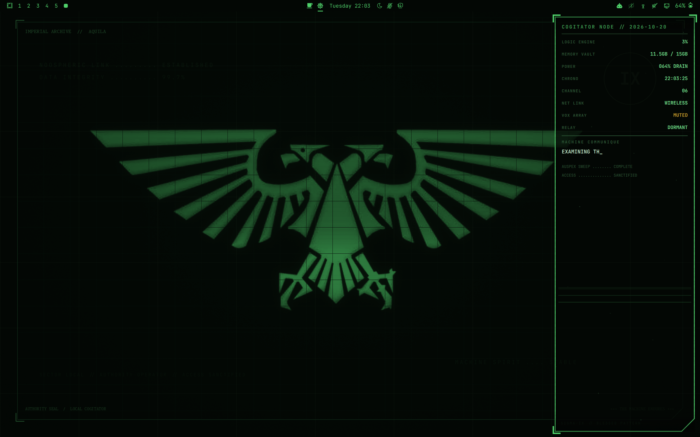
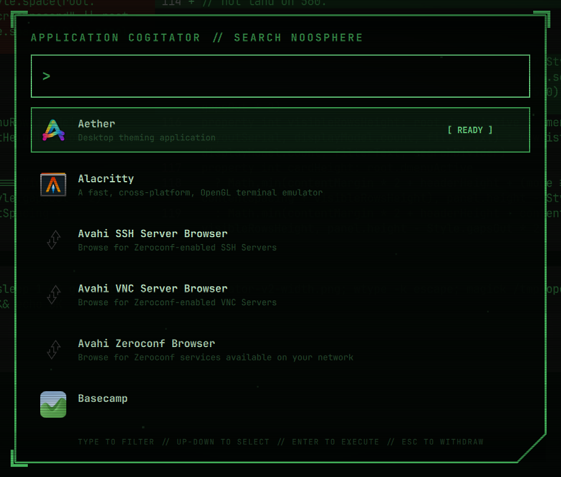
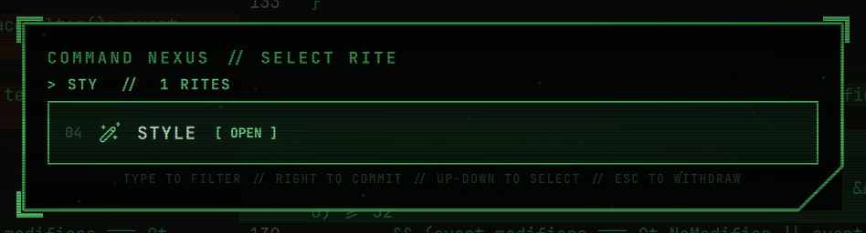
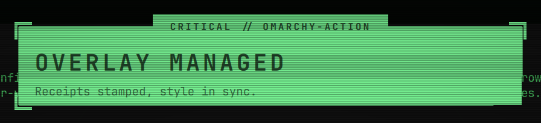
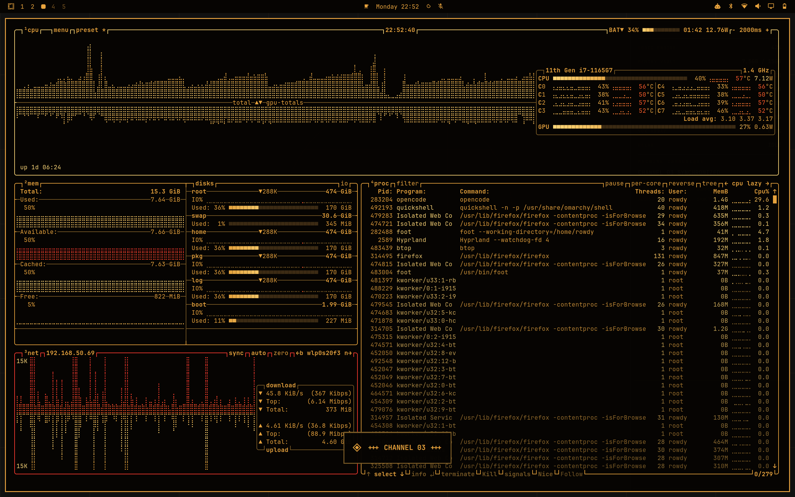

# Omarchy Cogitator v2 — Imperial Cogitator Shell

**A 40K cogitator that happens to run Linux.** Green-phosphor displays, machine-spirit communiques, industrial frames, and Mechanicus-styled widgets for Omarchy 4.x / Quickshell.

[](docs/screenshots/desktop-aquila.png)

*The phosphor desktop: Aquila wallpaper, industrial bar icons, and a persistent Auspex console with live machine telemetry. Click any screenshot for the full-size image.*

- **Command Nexus & Application Cogitator** — keyboard-driven commands and application search.
- **A complete shell suite** — stock-based widgets with shared chamfered frames, native industrial icons, and Mechanicus vocabulary.
- **Control Sanctum** — a persistent widget beside the clock for mode switching, palettes, and settings.
- **Reversible engagement** — restore your previous theme, widget selection, and bar layout when you disengage.

[Usage](#usage) · [Control widget](docs/control-widget.md) · [Settings](#settings) · [Palettes](#palettes) · [Wallpapers](#make-your-own-background) · [Architecture](docs/architecture.md)

## A closer look

<table>
  <tr>
    <td width="50%" valign="top">
      <h3>Application Cogitator</h3>
      <a href="docs/screenshots/showcase/application-cogitator.png"></a>
      <p>Native application search inside a phosphor terminal, with keyboard navigation and recognizable app icons.</p>
    </td>
    <td width="50%" valign="top">
      <h3>Command Nexus</h3>
      <a href="docs/screenshots/showcase/command-nexus.png"></a>
      <p>Type to filter directives; use the keyboard to select and execute a rite.</p>
      <h3>Machine Herald</h3>
      <a href="docs/screenshots/showcase/machine-herald.png"></a>
      <p>Notifications share the terminal framing, with high-contrast severity styling for critical alerts.</p>
    </td>
  </tr>
</table>

<details>
<summary><strong>Amber palette in action</strong></summary>

[](docs/screenshots/palette-amber-btop.png)

*Amber doctrine with a matching terminal palette. Green, red, industrial, and custom phosphor palettes are also available.*

</details>

*These captures show the project's visual design; labels and bar icons have evolved during development. [Browse all screenshots](docs/screenshots/).*

## Safety contract

* Only user locations are ever touched:
  * `~/.config/omarchy/themes/cogitator-*/`
  * `~/.config/omarchy/plugins/cogitator-rite/` and `cogitator.*/`
  * `~/.config/cogitator-v2/`
  * `~/.local/state/cogitator-v2/`
* Never edit `/usr/share/omarchy/`, never edit stock themes, never overwrite `shell.json` without timestamped backup.
* `cogitator enable` snapshots, `cogitator disable` restores, `cogitator uninstall` removes only what it installed.
* TTY recovery: `cogitator disable`, then inspect `cogitator status` and transition logs.

## Current phase

Stock-based replacement suite: `cogitator enable` installs all 37 plugins and
switches the currently enabled components to their Cogitator replacements.
Unused widgets and disabled services stay off. Existing custom clone files,
repeated widget instances, settings and bar placement are preserved.
See [suite switching](docs/suite-switching.md) and [architecture](docs/architecture.md).

## Usage

```bash
./tests/test.sh          # regression checks; uses temporary/generated fixtures
cogitator status         # ~/.local/bin/cogitator shim, installed on enable
./scripts/cogitator install   # adds persistent control widget beside the clock; stays disengaged
./scripts/cogitator enable    # snapshots, native-installs plugin+theme, queues detached transition
./scripts/cogitator disable   # restores original routes, bar, theme and background
./scripts/cogitator apply     # deploy working-tree QML + replacement plugins, restart shell
./scripts/cogitator suite status # detailed suite journal and selected replacements
./scripts/cogitator configure # edit ~/.config/cogitator-v2/cogitator.conf
./scripts/cogitator uninstall # disable first, then `plugin remove` + `theme remove` (keeps config; --purge removes all)
```

Native commands manage individual components. They do not replace the suite's
snapshot/restore workflow; use `cogitator enable` and `disable` for full switching:

```bash
omarchy plugin add https://github.com/Rowdydangerous/omarchy-cogitator-v2 --yes
omarchy plugin enable cogitator-rite
omarchy theme set cogitator-green
omarchy plugin disable cogitator-rite
```

Enable/disable queue a transient `cogitator-v2-transition` user unit and
return immediately. Theme changes retint/restart terminals and may interrupt
the invoking terminal or OpenCode. Enable mounts the suite through the config
watcher; disable finishes with a shell restart. Ordinary panel settings update
live without restarting Quickshell or redeploying plugin sources.
Poll with `status`, inspect with
`journalctl --user -u cogitator-v2-transition --no-pager`.
An abort message right after enable/disable means your shell died, not the
transaction; re-check `status` before doing anything.

Scope: a stock-based Cogitator twin of the Quickshell widgets and panels,
green phosphor first, Xenon-first font stack with clean fallback. The console
and background burn are additional machine surfaces.

## Global CRT (all windows)

`CRT_GLOBAL=true` (default) routes every window through a compositor
screen shader: static scanlines + vignette, rendered from
`hypr/crt.frag.tpl` with your `CRT_INTENSITY`. It darkens only, never
recolors, and costs ~1% compositor CPU idle because it is static —
Hyprland refuses `time` uniforms without disabling damage tracking
(entire frames re-rendered constantly), so flicker and grain stay in the
small-region QML overlays instead. While the global treatment is on, the
QML scanlines soften automatically to avoid doubling.

Managed as a marker-guarded `hl.config` block in
`~/.config/hypr/looknfeel.lua` (backed up before first edit, removed on
disable/uninstall). A foreign `screen_shader` is never clobbered — the
installer stands down with a message instead.

## Performance

Earlier console-prototype observations of whole-Quickshell lifetime CPU on an
i7-1165G7 (not isolated benchmarks of the expanded replacement suite):

| Tier | Cost | Motion |
|------|------|--------|
| `minimal` | ~4% (near stock) | frozen consoles, telemetry text still updates |
| `normal` | ~7% | stepped scan sweep + streaming text |
| `full` | ~10% | + flicker, grain, rite rotation |

Design rules that earned this: no full-screen tweens (a 120s background
drift cost ~15% alone — cut), stepped carriage motion at ~8fps instead of
60fps glides, damage-small-region overlays, event-driven bindings over
polling, 5s telemetry cadence. Set `ANIMATION_LEVEL` in `cogitator.conf`,
then `cogitator apply`.

## Full shell suite

A full Cogitator twin of Omarchy's shell is the main scope. Each plugin starts
from stock behavior and is styled individually. The inventory and migration
boundaries are in [architecture](docs/architecture.md).

## Settings

```bash
cogitator configure   # opens ~/.config/cogitator-v2/cogitator.conf in $EDITOR;
                      # if you save changes it applies them automatically,
                      # otherwise the shell is left untouched
cogitator apply       # source-development deployment + one full shell restart
cogitator status      # theme, palette, plugin, snapshot in one glance
```

Supported tunables live in that one file: palette, CRT intensity,
flicker, noise, persistence, ghosting, burn-in,
background burn + opacity, text streaming, workspace rites, prop opacity
and position, animation tier. QML never hardcodes color — all shell
surfaces follow the active theme file live.

## Palettes

```bash
cogitator palette amber       # warm amber CRT
cogitator palette red         # damage-control emergency terminal
cogitator palette industrial  # gunmetal, aged cream, brass
cogitator palette green       # back to phosphor green
```

Custom phosphor: set `CUSTOM_PHOSPHOR="#7CFF6B"` in the conf, then
`cogitator palette custom`. Scales derive automatically; bar, menus,
notifications, lock, launcher, prop, and burn all follow because every
surface reads the theme file. Definitions live in `palettes/*.json`,
rendered by `palettes/render.py` (green also ships at the repo root as
the native-installable flagship).

## Make your own background

The wallpaper renderer turns your artwork into a static phosphor image with
bloom, scanlines, grain, and a chamfered frame. It requires **Pillow and NumPy**.
On the development Omarchy machine, use `/usr/bin/python3`; the mise `python`
environment does not have those libraries.

### Theme folders

Keep full-resolution wallpapers in the matching theme's folder:

| Theme | Wallpaper folder | `--phosphor` | `--background` |
| --- | --- | --- | --- |
| Green | `backgrounds/` | `'#4fd06a'` | `'#030704'` |
| Amber | `themes/cogitator-amber/backgrounds/` | `'#e8a33d'` | `'#060402'` |
| Red | `themes/cogitator-red/backgrounds/` | `'#e03a30'` | `'#070202'` |
| Industrial | `themes/cogitator-industrial/backgrounds/` | `'#e8dcc0'` | `'#0b0b09'` |
| Custom | `themes/cogitator-custom/backgrounds/` | Your phosphor hex | Your background hex |

Green lives at the root because the repository itself is its native Omarchy
theme. The Aquila wallpaper is the default when enabling Cogitator Green or
switching to the green palette; the plain grid remains available as an alternative.
Custom theme files are generated when you select the custom palette.
Previews belong in **`docs/wallpaper-previews/<palette>/`**, with a folder for
each of `green`, `amber`, `red`, `industrial`, and `custom`. Omarchy does not
use these as thumbnails; a preview in `backgrounds/` becomes a duplicate
wallpaper choice.

### Render an image

Run this from any directory, substituting your source image and a **new `.png`
filename** for the output:

```bash
REPO="$HOME/Projects/omarchy-cogitator-v2"
/usr/bin/python3 "$REPO/scripts/render-wallpaper.py" \
  "$HOME/Downloads/Cog_background/mechSkull3.jpg" \
  "$REPO/backgrounds/my-mech-skull.png" \
  --preview-dir "$REPO/docs/wallpaper-previews/green" \
  --mode image \
  --title "IMPERIAL ARCHIVE  //  MECHANICUS"
```

- `--mode image` preserves the complete composition. Add `--invert` for dark
  artwork on a pale background.
- `--mode gold`, `--mode green`, or `--mode saturation` extracts a colored
  emblem from a neutral background.
- `--gamma 1.6` suppresses faint details; `--brightness 1.3` boosts intensity.
- `--size 2560x1600` sets resolution (also the default).
- `--no-grid` avoids adding another grid to artwork that already has one.
- For another palette, change the output and preview folders and add the two
  color arguments from the table above. Coloring is explicit, not inferred
  from the destination folder.

The script preserves your source and refuses to overwrite existing outputs.
Output and preview directories must exist; the second positional argument is
a filename, not a directory. See [the full guide](docs/wallpapers.md) or run
`/usr/bin/python3 "$REPO/scripts/render-wallpaper.py" --help` for all controls.

### Make it available in Omarchy

Adding images to the repository does not update an already-installed theme.
For Green, copy the full-resolution PNGs to Omarchy's user-background folder:

```bash
mkdir -p "$HOME/.config/omarchy/backgrounds/cogitator-green"
cp -n "$REPO/backgrounds/"*.png \
  "$HOME/.config/omarchy/backgrounds/cogitator-green/"
```

For another palette, use its wallpaper folder from the table and the matching
destination `~/.config/omarchy/backgrounds/cogitator-<palette>/`. Reopen the
background selector while that theme is active. These user-background copies
also survive theme reinstalls.

To apply one file directly after reviewing its preview:

```bash
omarchy theme bg set "$REPO/backgrounds/my-mech-skull.png"
```

## Terminal rite (opt-in)

This optional terminal extra is separate from core installation. See
[extras/bash/README.md](extras/bash/README.md) for manual installation. Once
installed, activate it in an interactive Bash terminal:

```bash
[ -r ~/.config/cogitator-v2/bash/cogitator.bash ] && source ~/.config/cogitator-v2/bash/cogitator.bash
```

While engaged the prompt becomes a green `[NOOSPHERE::host]` authorization
line with a restrained machine-spirit utterance every 30 prompts; on disable
the original prompt returns by itself. `cogitator_rite_disable` removes the
hook entirely.

## Command menu (SUPER+SPACE while engaged)

`cogitator enable` routes SUPER+SPACE through `scripts/cogitator-menu`:
engaged it toggles the grimdark Command Nexus (stock root routes with
original icons, generated from stock data), disengaged it falls through to
the stock menu. Selecting APPLICATIONS opens the Application Cogitator;
every other rite delegates to the stock `omarchy.menu` at its route, so
the shell routes it to the active Cogitator menu replacement. Widgets and
panels use the stock-based suite replacements. Direct IPC also works:

```bash
omarchy-shell cogitator-rite toggleMenu    # root rites
omarchy-shell cogitator-rite openLauncher  # straight to applications
```

## Layout

The repo root is deliberately both a native plugin root and a native
theme root, so Omarchy's own installers accept it directly:

* `manifest.json` + `qml/` — plugin `cogitator-rite` (prop + burn service).
  `omarchy plugin add <url>` installs id `cogitator-rite` from any clone URL.
* `colors.toml` + `shell.toml` + `backgrounds/` + `icons.theme` — green
  phosphor theme, generated from `palettes/green.json` via
  `palettes/render.py`. `omarchy theme install <url>` works; the theme slug
  then derives from the repo name, while `scripts/cogitator` pins the
  curated slug `cogitator-green`.
* `palettes/` — centralized color definitions (single source of truth)
* `config/` — single `cogitator.conf` example → `config.json` for QML
* `docs/reference/microcopy.md` — microcopy inventory + liturgical replacements
* `scripts/cogitator` — lifecycle wrapper (snapshot/restore) around the
  native `omarchy plugin` / `omarchy theme` commands
* `docs/reference/fonts.md` — font investigation log
* `plugins/` — complete stock-based replacements, deployed by enable/apply
* `extras/bash/` — manually installed terminal prompt integration
* `docs/stock-baseline.json` — imported release and original file hashes
* `shared/frames/` — common menu-style chamfers, outlines and corner flares
* `shared/voice/` — Mechanicus labels, prompts, statuses and widget catalogue names
* `shared/icons/` — native industrial bar/state icons, Clipboard data-slate and Clock dial
* `control/` — persistent Control Sanctum widget and all-settings schema

## Control Sanctum

Run `cogitator install`, then click the sigil immediately left of the clock.
Engage/disengage and adjust settings with Apply/Revert; the widget stays available
when the suite is off. See [control widget](docs/control-widget.md).
