# Omarchy Cogitator — Imperial Cogitator Shell

**A 40K cogitator that happens to run Linux.** Green-phosphor displays, machine-spirit communiques, industrial frames, and Mechanicus-styled widgets for Omarchy 4.x / Quickshell.

[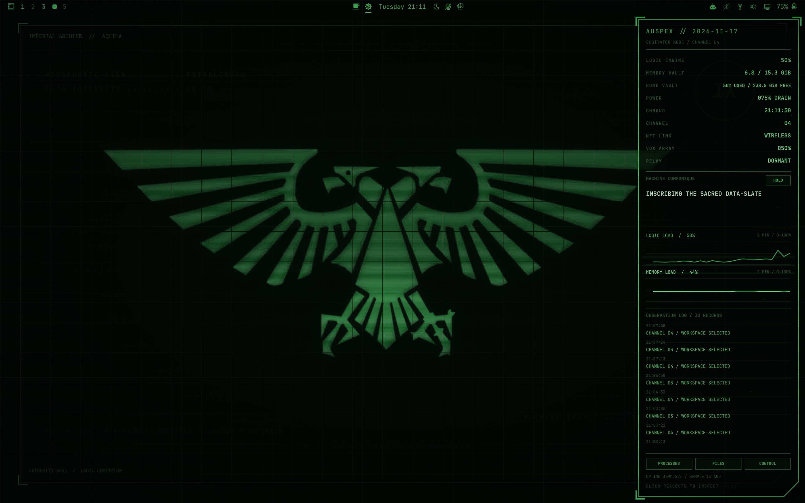](docs/screenshots/current/imperium.webp)

*Imperium: Aquila wallpaper, industrial bar icons, and a persistent Auspex console with live telemetry. Fresh captures from November 17, 2026; click any image to inspect it.*

- **Command Nexus & Application Cogitator** — keyboard-driven commands and application search.
- **A complete shell suite** — stock-based widgets with shared chamfered frames, native industrial icons, and Mechanicus vocabulary.
- **Control Sanctum** — a persistent widget beside the clock for mode switching, palettes, and settings.
- **Interactive Auspex** — clickable readouts, measured CPU/memory histories, a factual observation log, and event-driven machine-spirit commentary with Hold/Resume.
- **Four palettes** — Imperium, Ryza, Holy Mars, and Metalica, each remembering its own wallpaper.
- **Reversible engagement** — restore your previous theme, widget selection, and bar layout when you disengage.

[Usage](#usage) · [Updating](#updating) · [Control widget](docs/control-widget.md) · [Settings](#settings) · [Palettes](#palettes) · [Wallpapers](#make-your-own-background) · [Architecture](docs/architecture.md)

**Interactive Auspex:** click telemetry to inspect your machine, follow measured
CPU/memory history, and read a slower, event-driven machine-spirit stream with
Hold/Resume. [Console controls and observation details](docs/auspex-console.md).

## Four palettes, one shell

<table>
  <tr>
    <td width="50%"><strong>Imperium</strong> · green phosphor<br><a href="docs/screenshots/current/imperium.webp"></a></td>
    <td width="50%"><strong>Ryza</strong> · amber CRT<br><a href="docs/screenshots/current/ryza.webp">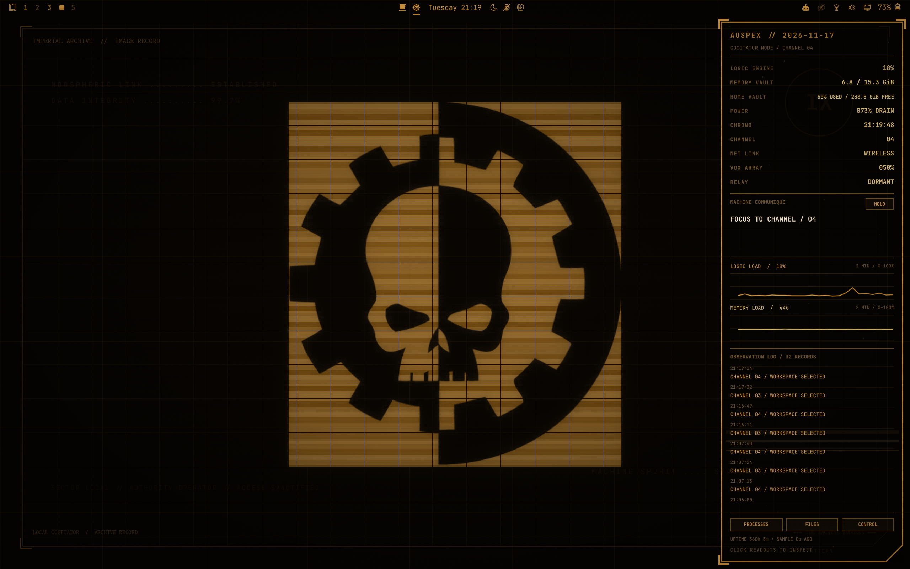</a></td>
  </tr>
  <tr>
    <td><strong>Holy Mars</strong> · red terminal<br><a href="docs/screenshots/current/holy-mars.webp">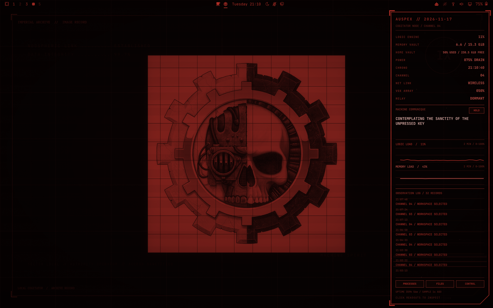</a></td>
    <td><strong>Metalica</strong> · aged cream and brass<br><a href="docs/screenshots/current/metalica.webp">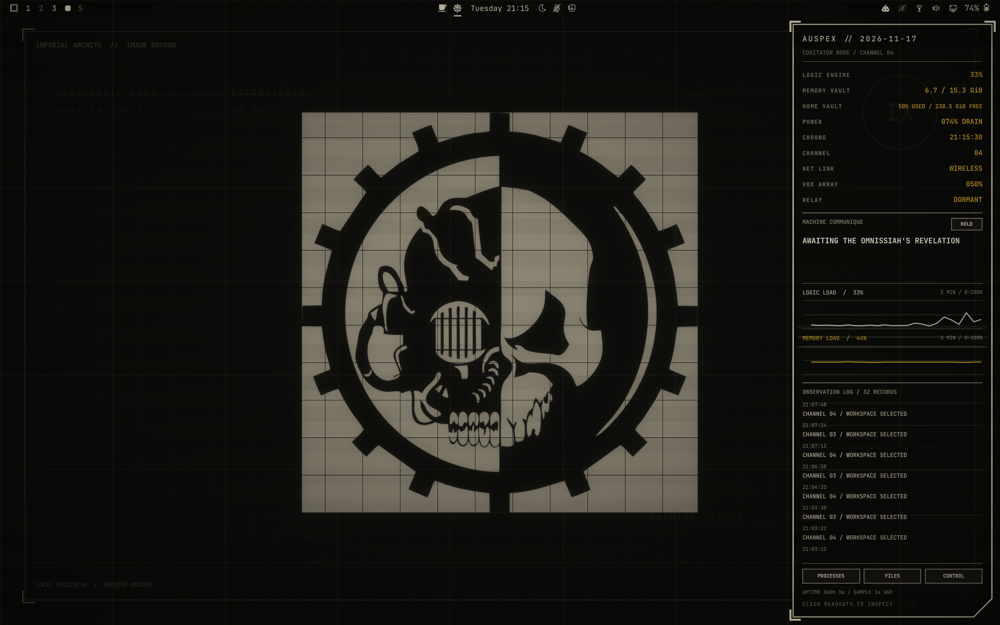</a></td>
  </tr>
</table>

Wallpaper choices are independent of palette selection. These captures use a
lighter CRT intensity for readability; both the CRT strength and artwork are configurable.

## A closer look

<table>
  <tr>
    <td width="50%" valign="top">
      <h3>Global application & command search</h3>
      <a href="docs/screenshots/current/application-search.webp">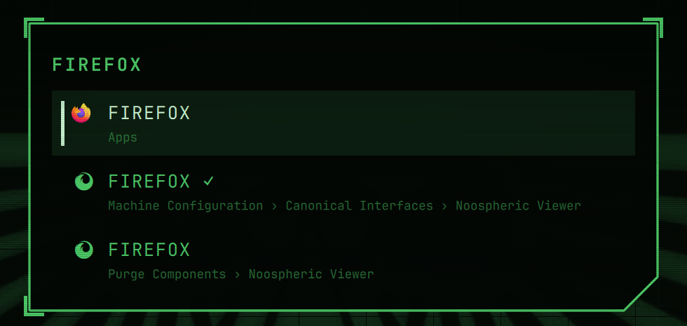</a>
      <p>Super+Space searches applications and native menu commands together. App results launch directly, with keyboard navigation and recognizable icons.</p>
      <h3>Machine Herald</h3>
      <a href="docs/screenshots/current/machine-herald.webp">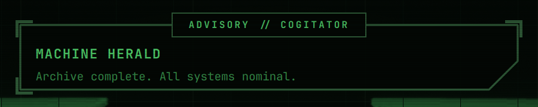</a>
      <p>Notifications share the shell's palette and terminal framing.</p>
    </td>
    <td width="50%" valign="top">
      <h3>Command Nexus</h3>
      <a href="docs/screenshots/current/command-nexus.webp">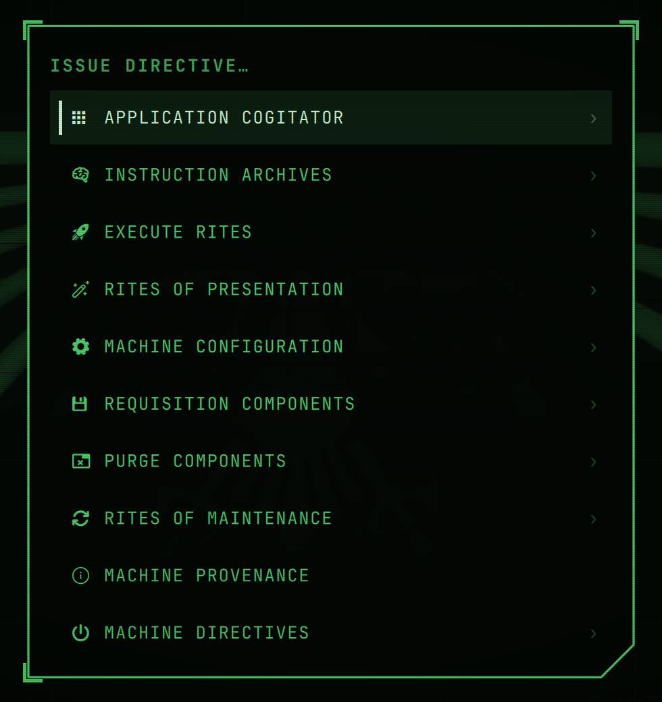</a>
      <p>Type to filter directives; use the keyboard to select and execute a rite.</p>
    </td>
  </tr>
  <tr>
    <td valign="top">
      <h3>Interactive Auspex</h3>
      <a href="docs/screenshots/current/auspex-tooltip.webp">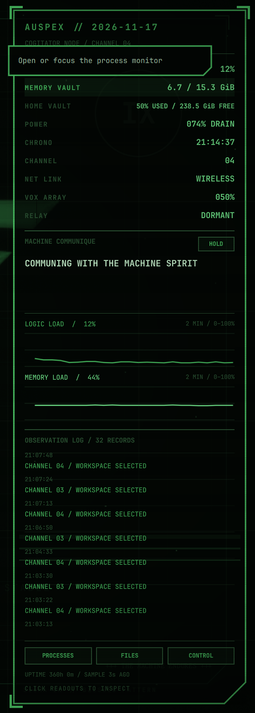</a>
      <p>Inspect processes, files and shell panels from the readouts. Real history charts and a factual event log sit beside restrained machine-spirit commentary.</p>
    </td>
    <td valign="top">
      <h3>Control Sanctum</h3>
      <a href="docs/screenshots/current/control-appearance.webp">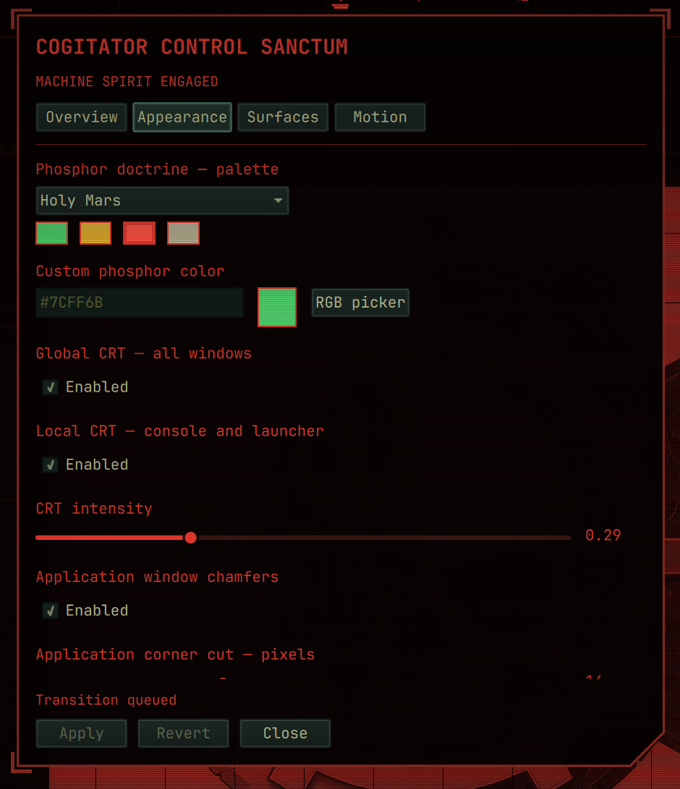</a>
      <p>Choose palettes, adjust CRT effects, and configure surfaces and motion without hand-editing files. Ordinary settings apply live.</p>
    </td>
  </tr>
  <tr>
    <td valign="top">
      <h3>Noospheric link</h3>
      <a href="docs/screenshots/current/network.webp">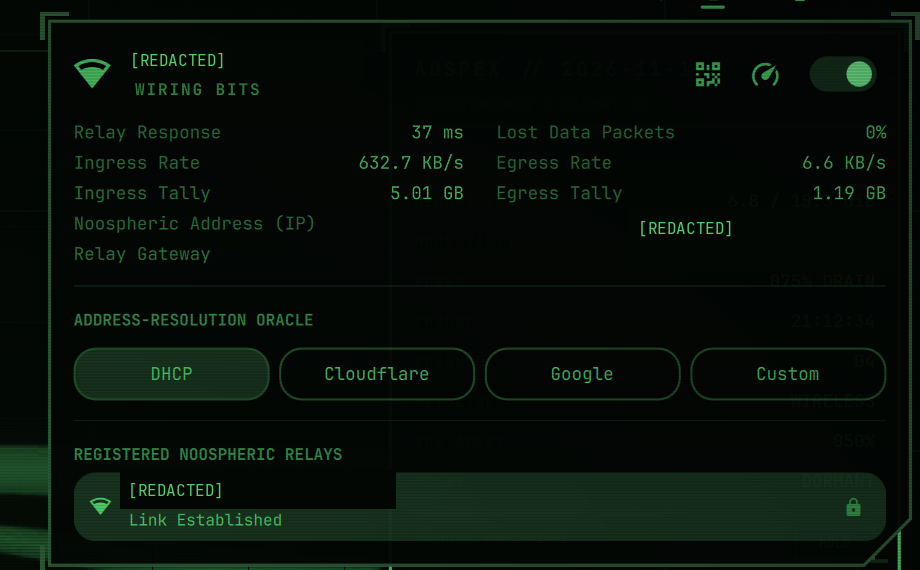</a>
      <p>Stable transfer columns, separate wrapping IP/gateway rows, DNS choices and Wi-Fi controls. Network identifiers are redacted in this capture.</p>
    </td>
    <td valign="top">
      <h3>Agent telemetry</h3>
      <a href="docs/screenshots/current/agents.webp">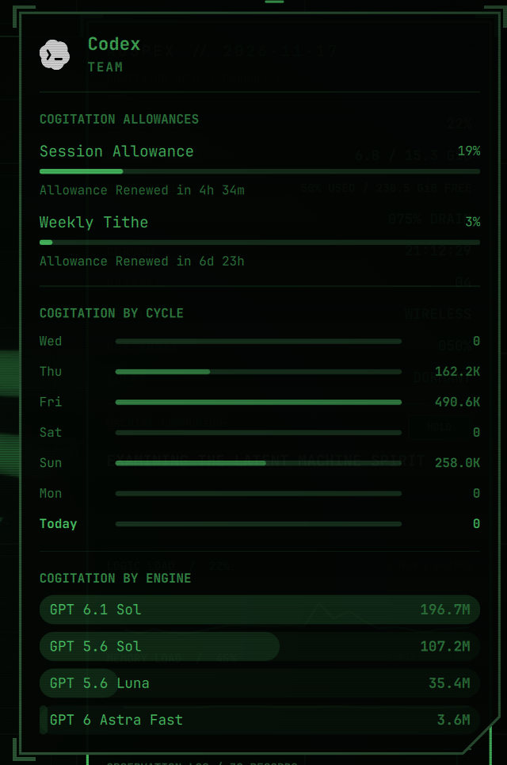</a>
      <p>Session and weekly allowances, daily usage, and model totals in the same visual language.</p>
    </td>
  </tr>
</table>

[Full screenshot gallery](docs/screenshots/current/README.md): standalone launcher,
surface settings, audio, display, power, and calendar panels, plus all four desktops.
Older development captures remain in [the screenshot archive](docs/screenshots/).

## Safety contract

* Only user locations are ever touched:
  * `~/.config/omarchy/themes/cogitator-*/`
  * `~/.config/omarchy/plugins/cogitator-rite/` and `cogitator.*/`
  * `~/.config/cogitator-v2/`
  * `~/.local/state/cogitator-v2/`
* Never edit `/usr/share/omarchy/`, never edit stock themes, never overwrite `shell.json` without timestamped backup.
* `cogitator enable` snapshots, `cogitator disable` restores, `cogitator uninstall` removes only what it installed.
* TTY recovery: `cogitator disable`, then inspect `cogitator status` and transition logs.

## Current phase

Stock-based replacement suite: `cogitator enable` installs all 37 plugins and
switches the currently enabled components to their Cogitator replacements.
Unused widgets and disabled services stay off. Existing custom clone files,
repeated widget instances, settings and bar placement are preserved.
See [suite switching](docs/suite-switching.md) and [architecture](docs/architecture.md).

## Usage

```bash
./tests/test.sh          # regression checks; uses temporary/generated fixtures
cogitator status         # ~/.local/bin/cogitator shim, installed on enable
./scripts/cogitator install   # adds persistent control widget beside the clock; stays disengaged
./scripts/cogitator enable    # snapshots, native-installs plugin+theme, queues detached transition
./scripts/cogitator disable   # restores original routes, bar, theme and background
./scripts/cogitator apply     # deploy working-tree QML + replacement plugins, restart shell
cogitator update             # download GitHub main and deploy, without editing runtime Git clones
./scripts/cogitator suite status # detailed suite journal and selected replacements
./scripts/cogitator configure # edit ~/.config/cogitator-v2/cogitator.conf
./scripts/cogitator uninstall # disable first, then `plugin remove` + `theme remove` (keeps config; --purge removes all)
```

Native commands manage individual components. They do not replace the suite's
snapshot/restore workflow; use `cogitator enable` and `disable` for full switching:

```bash
omarchy plugin add https://github.com/Rowdydangerous/omarchy-cogitator-v2 --yes
omarchy plugin enable cogitator-rite
omarchy theme set cogitator-green
omarchy plugin disable cogitator-rite
```

Enable/disable queue a transient `cogitator-v2-transition` user unit and
return immediately. Theme changes retint/restart terminals and may interrupt
the invoking terminal or OpenCode. Enable mounts the suite through the config
watcher; disable finishes with a shell restart. Ordinary panel settings update
live without restarting Quickshell or redeploying plugin sources.
Poll with `status`, inspect with
`journalctl --user -u cogitator-v2-transition --no-pager`.
An abort message right after enable/disable means your shell died, not the
transaction; re-check `status` before doing anything.

Scope: a stock-based Cogitator twin of the Quickshell widgets and panels,
green phosphor first, Xenon-first font stack with clean fallback. The console
and background burn are additional machine surfaces.

## Updating

Run **`cogitator update`**, or click **Update from GitHub** on Control Sanctum's
Overview page. Updates run in the background; the control widget shows completion
or failure, and logs are available through:

```bash
journalctl --user -u cogitator-v2-transition -n 60 --no-pager
```

The updater maintains a dedicated source checkout at
`~/.local/share/cogitator-v2/source/` (or under `XDG_DATA_HOME`). It does not pull
Git changes into the generated runtime plugins or edit your original project
clone. Active installations redeploy the suite and restart the shell once;
disengaged installations update the controller and stay disengaged. Settings,
the selected palette/wallpaper, and restore journals are retained. Theme assets
are downloaded, but the active theme is not reapplied; reselect its palette to
apply theme-file changes. Edited or foreign runtime files cause a refusal rather
than being reset or overwritten.

**Already installed an older version without this command?** You can bootstrap
the updater from a fresh source checkout; removal is not normally needed. See
[updating and reinstalling](docs/updating.md) for the one-time migration, manual
Git instructions, and safe reinstall steps. Do not remove only `cogitator-rite`
while its replacement suite is engaged.

## Global CRT (all windows)

`CRT_GLOBAL=true` (default) routes every window through a compositor
screen shader: static scanlines + vignette, rendered from
`hypr/crt.frag.tpl` with your `CRT_INTENSITY`. It darkens only, never
recolors, and costs ~1% compositor CPU idle because it is static —
Hyprland refuses `time` uniforms without disabling damage tracking
(entire frames re-rendered constantly), so flicker and grain stay in the
small-region QML overlays instead. While the global treatment is on, the
QML scanlines soften automatically to avoid doubling.

Managed as a marker-guarded `hl.config` block in
`~/.config/hypr/looknfeel.lua` (backed up before first edit, removed on
disable/uninstall). A foreign `screen_shader` is never clobbered — the
installer stands down with a message instead.

## Performance

Earlier console-prototype observations of whole-Quickshell lifetime CPU on an
i7-1165G7 (not isolated benchmarks of the expanded replacement suite):

| Tier | Cost | Motion |
|------|------|--------|
| `minimal` | ~4% (near stock) | frozen consoles, telemetry text still updates |
| `normal` | ~7% | stepped scan sweep + streaming text |
| `full` | ~10% | + flicker, grain, rite rotation |

Design rules that earned this: no full-screen tweens (a 120s background
drift cost ~15% alone — cut), stepped carriage motion at ~8fps instead of
60fps glides, damage-small-region overlays, event-driven bindings over
polling, 5s telemetry cadence. Set `ANIMATION_LEVEL` in `cogitator.conf`,
then `cogitator apply`.

## Full shell suite

A full Cogitator twin of Omarchy's shell is the main scope. Each plugin starts
from stock behavior and is styled individually. The inventory and migration
boundaries are in [architecture](docs/architecture.md).

## Settings

```bash
cogitator configure   # opens ~/.config/cogitator-v2/cogitator.conf in $EDITOR;
                      # if you save changes it applies them automatically,
                      # otherwise the shell is left untouched
cogitator apply       # source-development deployment + one full shell restart
cogitator status      # theme, palette, plugin, snapshot in one glance
```

Supported tunables live in that one file: palette, CRT intensity,
flicker, noise, persistence, ghosting, burn-in,
background burn + opacity, text streaming, workspace rites, prop opacity
and position, animation tier. QML never hardcodes color — all shell
surfaces follow the active theme file live.

## Palettes

| Display name | Internal ID | Appearance | Default wallpaper |
| --- | --- | --- | --- |
| **Imperium** | `green` | Green phosphor | Aquila |
| **Ryza** | `amber` | Warm amber CRT | mechSkull3 |
| **Holy Mars** | `red` | Red emergency terminal | mechSkull1 |
| **Metalica** | `industrial` | Gunmetal, aged cream, brass | mechSkull2 |
| **Custom** | `custom` | Your own phosphor color | Generated grid |

The controller uses the display names; configuration values, CLI arguments,
theme IDs, and folder names keep their existing IDs for compatibility. The
display-name mapping lives in `control/settings-schema.json` (`PALETTE.choiceLabels`).
Default wallpaper filenames live in `palettes/*.json` (`defaultWallpaper`). These
are first-use defaults: each palette independently remembers the user's chosen
background afterward, including choices made through Omarchy's background selector.

```bash
cogitator palette amber       # Ryza
cogitator palette red         # Holy Mars
cogitator palette industrial  # Metalica
cogitator palette green       # Imperium
```

Custom phosphor: set `CUSTOM_PHOSPHOR="#7CFF6B"` in the conf, then
`cogitator palette custom`. Scales derive automatically; bar, menus,
notifications, lock, launcher, prop, and burn all follow because every
surface reads the theme file. Definitions live in `palettes/*.json`,
rendered by `palettes/render.py` (green also ships at the repo root as
the native-installable flagship).

## Make your own background

The wallpaper renderer turns your artwork into a static phosphor image with
bloom, scanlines, grain, and a chamfered frame. It requires **Pillow and NumPy**.
On the development Omarchy machine, use `/usr/bin/python3`; the mise `python`
environment does not have those libraries.

### Theme folders

Keep full-resolution wallpapers in the matching theme's folder:

| Theme | Wallpaper folder | `--phosphor` | `--background` |
| --- | --- | --- | --- |
| Imperium (green) | `backgrounds/` | `'#4fd06a'` | `'#030704'` |
| Ryza (amber) | `themes/cogitator-amber/backgrounds/` | `'#e8a33d'` | `'#060402'` |
| Holy Mars (red) | `themes/cogitator-red/backgrounds/` | `'#e03a30'` | `'#070202'` |
| Metalica (industrial) | `themes/cogitator-industrial/backgrounds/` | `'#e8dcc0'` | `'#0b0b09'` |
| Custom | `themes/cogitator-custom/backgrounds/` | Your phosphor hex | Your background hex |

Green lives at the root because the repository itself is its native Omarchy
theme. The Aquila wallpaper is the first-use green default; the plain grid
remains available as an alternative.
Custom theme files are generated when you select the custom palette.
Previews belong in **`docs/wallpaper-previews/<palette>/`**, with a folder for
each of `green`, `amber`, `red`, `industrial`, and `custom`. Omarchy does not
use these as thumbnails; a preview in `backgrounds/` becomes a duplicate
wallpaper choice.

### Render an image

Run this from any directory, substituting your source image. By default it
generates **all four palette variants** and makes them available to Omarchy:

```bash
REPO="$HOME/Projects/omarchy-cogitator-v2"
/usr/bin/python3 "$REPO/scripts/render-wallpaper.py" \
  "$HOME/Downloads/Cog_background/mechSkull3.jpg" \
  --mode image \
  --title "IMPERIAL ARCHIVE  //  MECHANICUS"
```

Full-resolution images go into
`~/.config/omarchy/backgrounds/cogitator-{green,amber,red,industrial}/` with the
same filename, such as `cogitator-mechSkull3-2560x1600.png`. Previews are kept
separately under `~/.cache/cogitator-v2/wallpaper-previews/<palette>/`.
Directories are created automatically; originals and existing outputs are never
overwritten. The palette colors come directly from `palettes/*.json`.

- `--mode image` preserves the complete composition. Add `--invert` for dark
  artwork on a pale background.
- `--mode gold`, `--mode green`, or `--mode saturation` extracts a colored
  emblem from a neutral background.
- `--gamma 1.6` suppresses faint details; `--brightness 1.3` boosts intensity.
- `--size 2560x1600` sets resolution (also the default).
- `--no-grid` avoids adding another grid to artwork that already has one.
- `--palette amber` generates only Ryza. Add an output filename for a single
  exact destination; custom `--phosphor`/`--background` colors require this
  single-palette mode.

The script preserves your source and refuses to overwrite existing outputs.
The optional second positional argument is a PNG base path: in default all-mode,
it writes `parent/cogitator-<palette>/filename.png`; with a single `--palette`,
it writes that exact file. See [the full guide](docs/wallpapers.md) or run
`/usr/bin/python3 "$REPO/scripts/render-wallpaper.py" --help` for all controls.

### Make it available in Omarchy

The default four-palette output is already in Omarchy's user-background folders.
Reopen the background selector, or select a variant directly:

```bash
omarchy theme bg set "$HOME/.config/omarchy/backgrounds/cogitator-green/cogitator-mechSkull3-2560x1600.png"
```

Choose whatever background you want for each palette. Changes through Cogitator's
controller or `cogitator palette` remember the background of the palette being
left and restore the destination palette's own selection. First use gets its
packaged default; selecting an image for Ryza never changes Holy Mars's choice.
This includes the custom palette. Saved copies survive theme reinstalls or a
source image being moved. Generation itself does not change any selection or
automatically link the four images.

Adding images only to the repository's theme folders does not update installed
themes. Copy those into the corresponding user-background folders if needed.

## Terminal rite (opt-in)

This optional terminal extra is separate from core installation. See
[extras/bash/README.md](extras/bash/README.md) for manual installation. Once
installed, activate it in an interactive Bash terminal:

```bash
[ -r ~/.config/cogitator-v2/bash/cogitator.bash ] && source ~/.config/cogitator-v2/bash/cogitator.bash
```

While engaged the prompt becomes a green `[NOOSPHERE::host]` authorization
line with a restrained machine-spirit utterance every 30 prompts; on disable
the original prompt returns by itself. `cogitator_rite_disable` removes the
hook entirely.

## Command menu (SUPER+SPACE while engaged)

`cogitator enable` routes SUPER+SPACE through `scripts/cogitator-menu`, using
the native `omarchy.menu` lifecycle. While engaged, the shell resolves it to
the themed stock-based Cogitator menu; while disengaged, it opens the original
menu. Typing searches applications and nested commands globally: `FOOT` and
`SCREENSHOT` do not require opening a submenu first. User JSONC extensions,
providers, conditions, and action behavior remain native. The standalone
Application Cogitator is still available through direct IPC:

```bash
omarchy-shell cogitator-rite toggleMenu    # themed native root menu
omarchy-shell cogitator-rite openLauncher  # straight to applications
```

## Layout

The repo root is deliberately both a native plugin root and a native
theme root, so Omarchy's own installers accept it directly:

* `manifest.json` + `qml/` — plugin `cogitator-rite` (prop + burn service).
  `omarchy plugin add <url>` installs id `cogitator-rite` from any clone URL.
* `colors.toml` + `shell.toml` + `backgrounds/` + `icons.theme` — green
  phosphor theme, generated from `palettes/green.json` via
  `palettes/render.py`. `omarchy theme install <url>` works; the theme slug
  then derives from the repo name, while `scripts/cogitator` pins the
  curated slug `cogitator-green`.
* `palettes/` — centralized color definitions (single source of truth)
* `config/` — single `cogitator.conf` example → `config.json` for QML
* `docs/reference/microcopy.md` — microcopy inventory + liturgical replacements
* `scripts/cogitator` — lifecycle wrapper (snapshot/restore) around the
  native `omarchy plugin` / `omarchy theme` commands
* `docs/reference/fonts.md` — font investigation log
* `plugins/` — complete stock-based replacements, deployed by enable/apply
* `extras/bash/` — manually installed terminal prompt integration
* `docs/stock-baseline.json` — imported release and original file hashes
* `shared/frames/` — common menu-style chamfers, outlines and corner flares
* `shared/voice/` — Mechanicus labels, prompts, statuses and widget catalogue names
* `shared/icons/` — native industrial bar/state icons, Clipboard data-slate and Clock dial
* `control/` — persistent Control Sanctum widget and all-settings schema

## Control Sanctum

Run `cogitator install`, then click the sigil immediately left of the clock.
Engage/disengage and adjust settings with Apply/Revert; the widget stays available
when the suite is off. See [control widget](docs/control-widget.md).
