# Current screenshot gallery

Captured on **November 17, 2026** from the running Cogitator suite on Omarchy.
Desktop originals are 2560 × 1600; feature images are crops at native resolution.
All images use lossless WebP, without contrast enhancement or reconstructed UI.
The lighter CRT setting used for this session was approximately 0.25–0.29.

Network names, IP and gateway addresses are covered with opaque, explicitly
marked redactions. Other readouts are real snapshots, not performance benchmarks.
The notification is a demonstration message, not an actual archive operation.

## Palettes

| Imperium · green phosphor | Ryza · amber CRT |
| --- | --- |
| [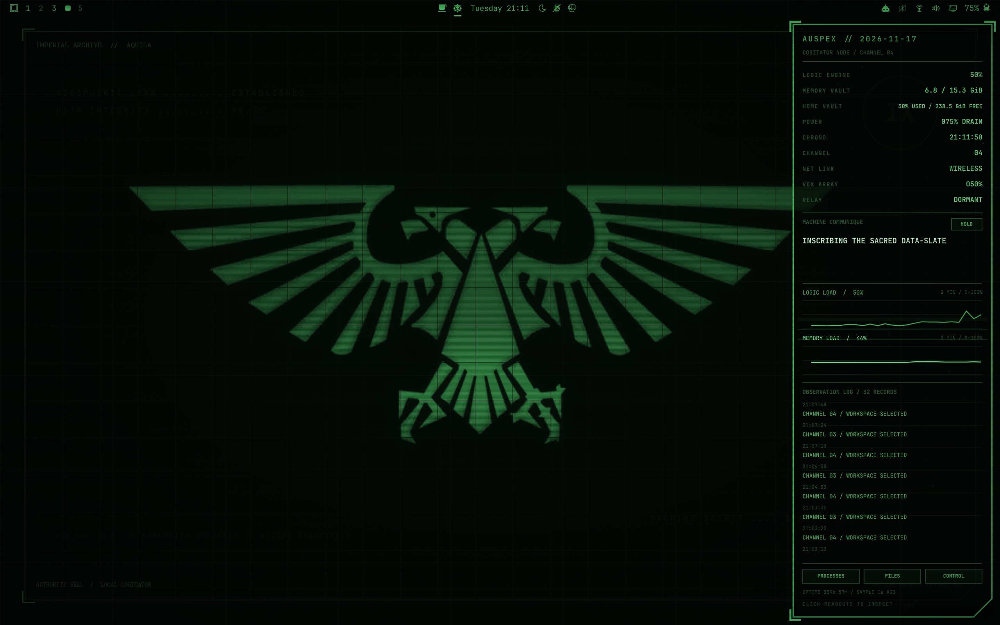](imperium.webp) | [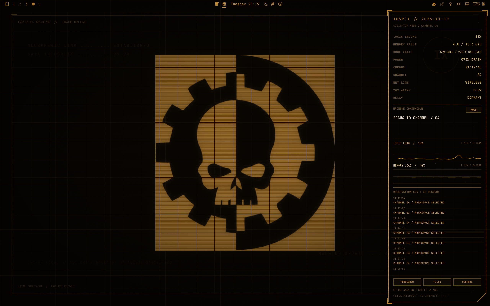](ryza.webp) |

| Holy Mars · red terminal | Metalica · cream and brass |
| --- | --- |
| [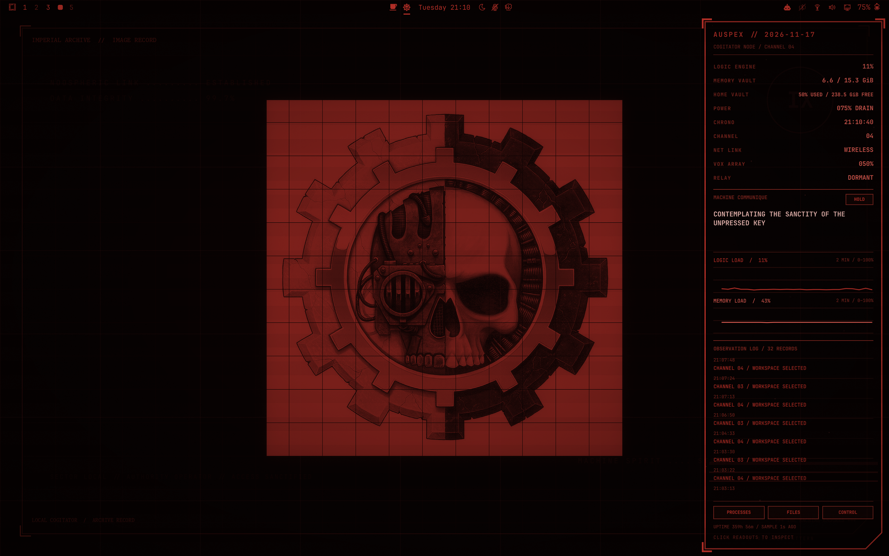](holy-mars.webp) | [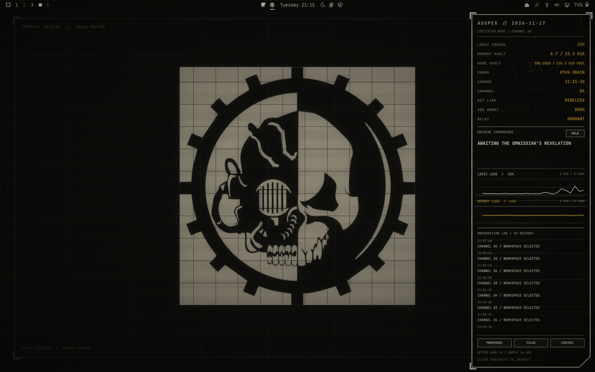](metalica.webp) |

Artwork is a separate, remembered choice for each palette. Ryza is shown with
its packaged `mechSkull3` artwork; the other desktops show the selected artwork
on the capture machine. Capturing did not replace the saved wallpaper choices.

## Search and commands

### Global application and command search

[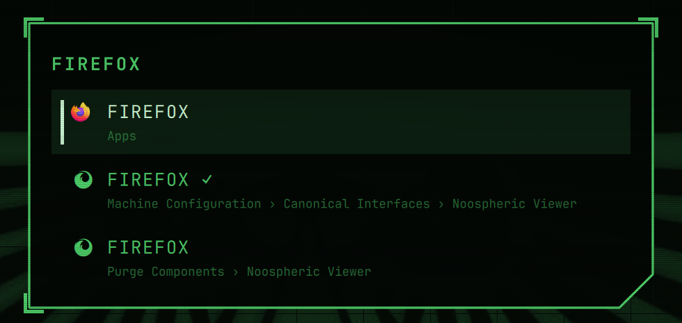](application-search.webp)

### Command Nexus

[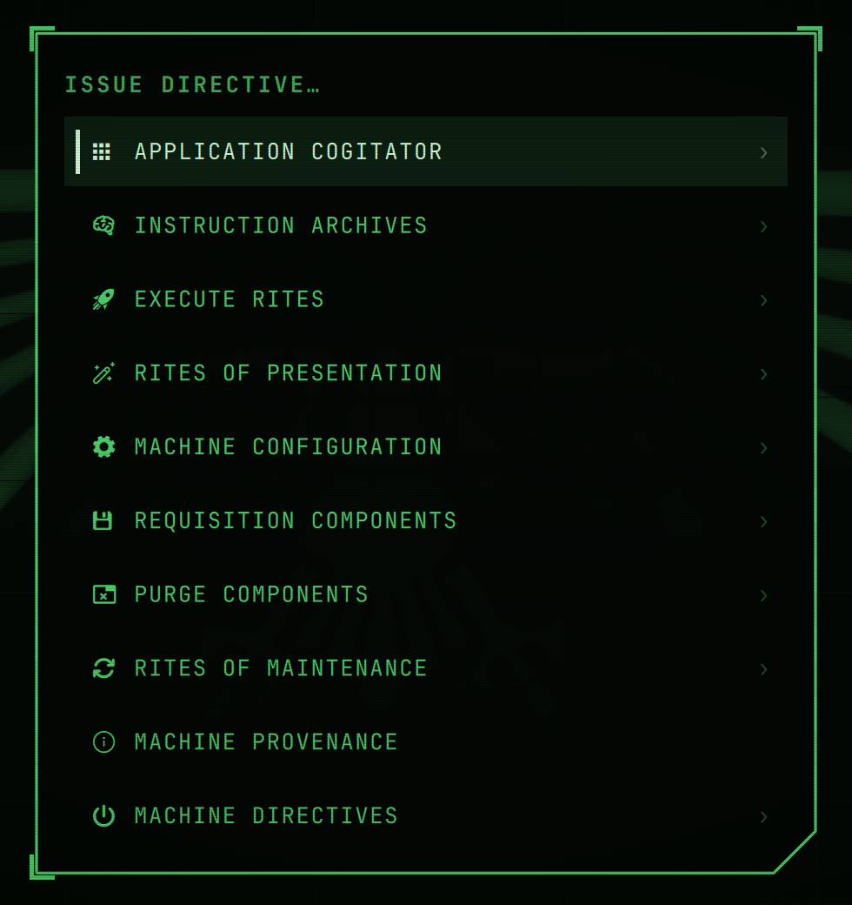](command-nexus.webp)

### Standalone Application Cogitator

[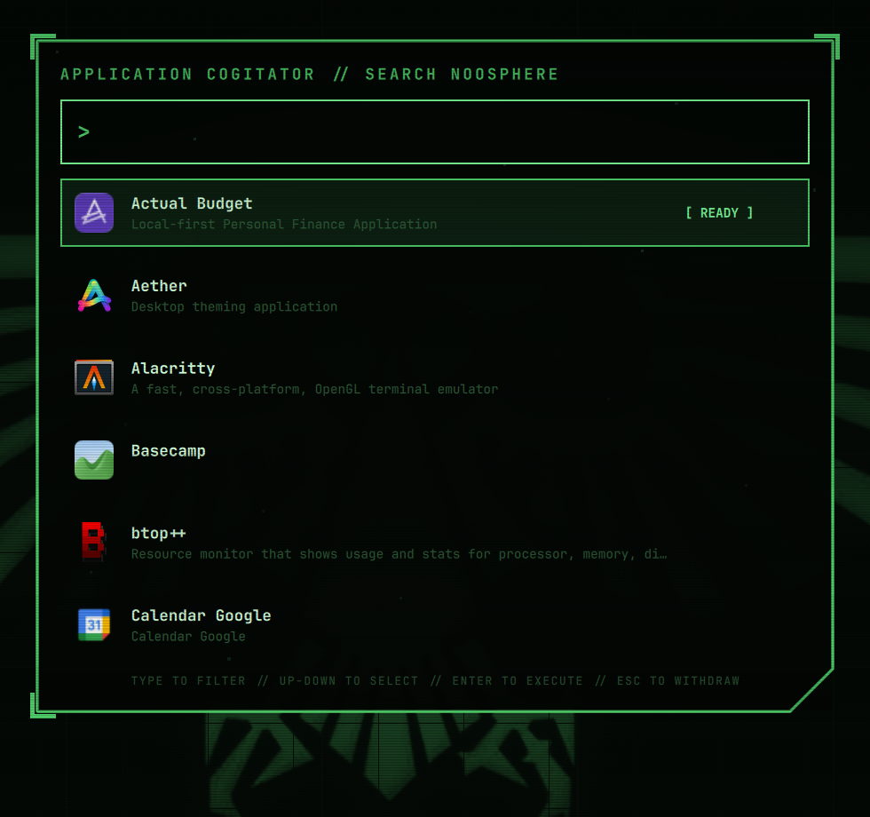](application-cogitator.webp)

## Interactive Auspex

Click readouts to inspect the corresponding subsystem. The tooltip follows the
palette; charts show measured CPU/memory history. The observation log records
events, while the separate machine-spirit stream offers Hold/Resume.

<a href="auspex-tooltip.webp">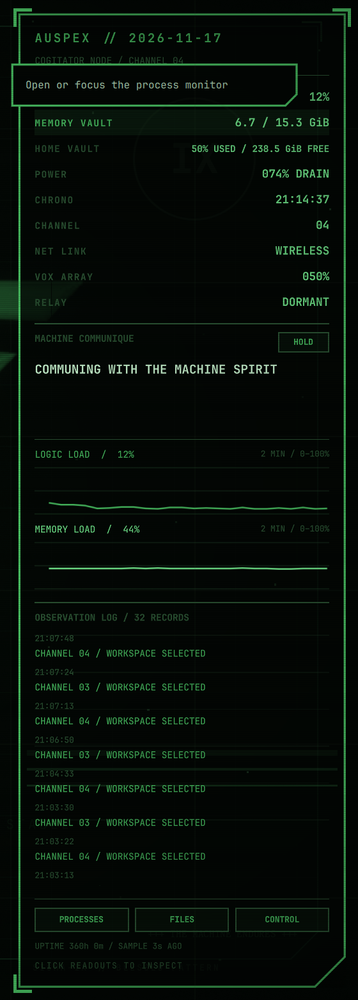</a>

## Control Sanctum

### Appearance

[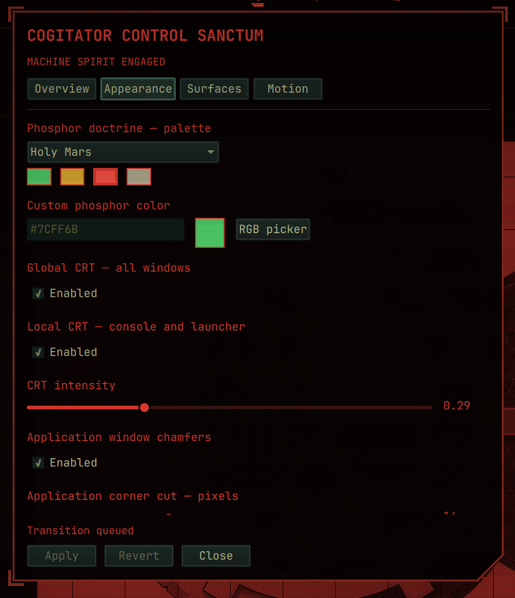](control-appearance.webp)

### Surfaces

[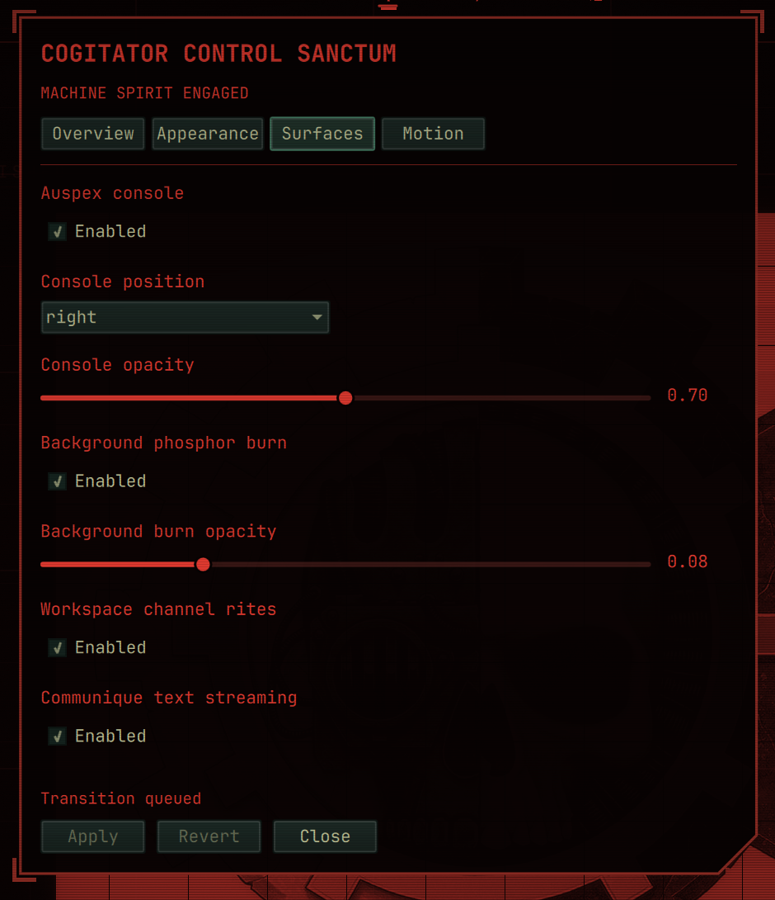](control-surfaces.webp)

## Shell panels

### Network

[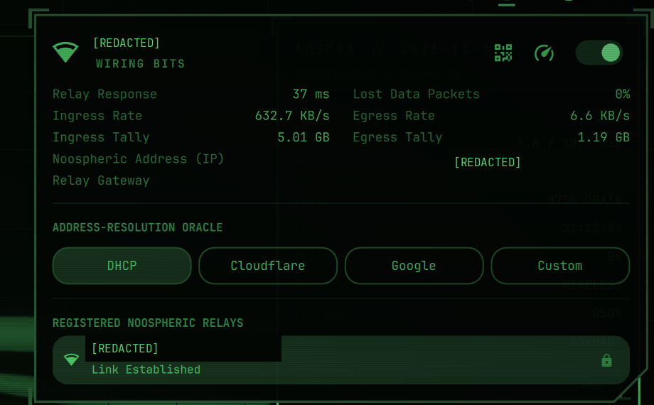](network.webp)

### Agents

[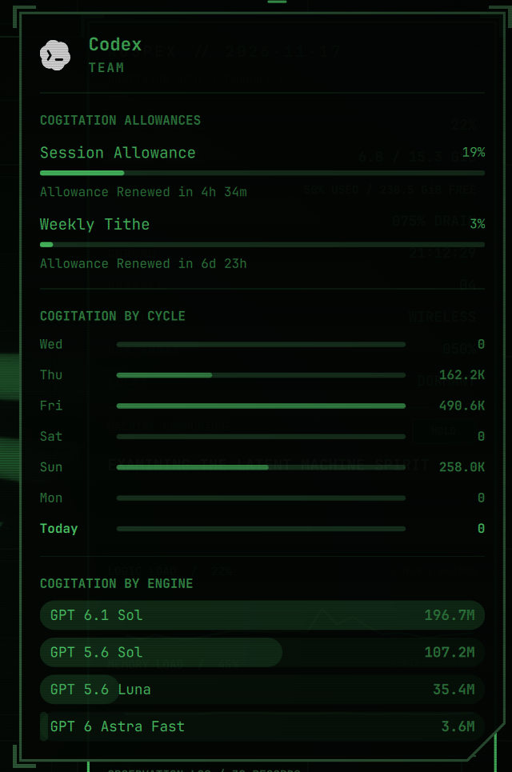](agents.webp)

### Audio

[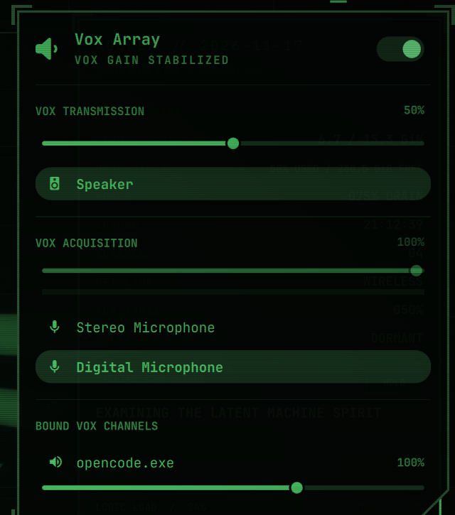](audio.webp)

### Display · Metalica

[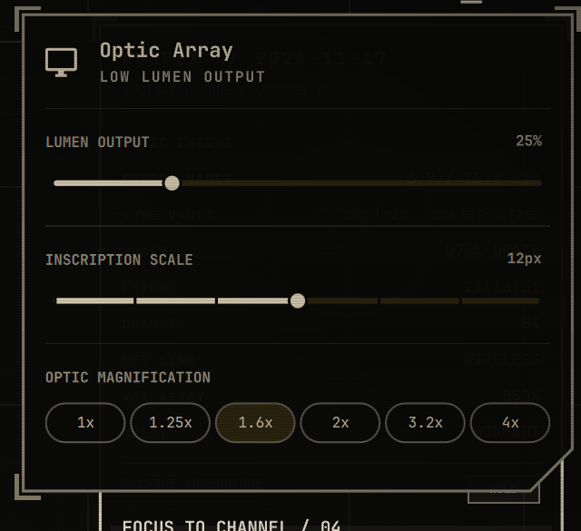](display.webp)

### Power

[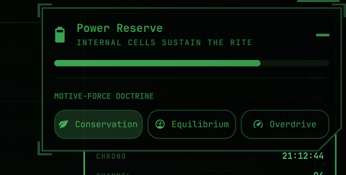](power.webp)

### Calendar

[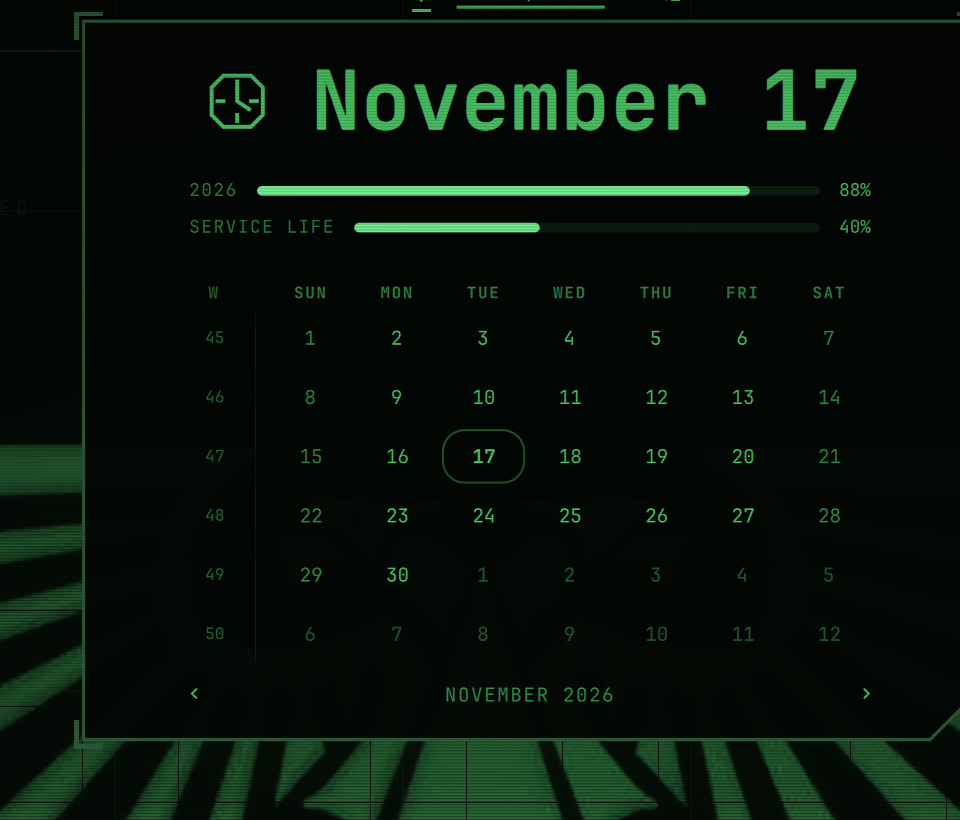](clock.webp)

## Machine Herald

[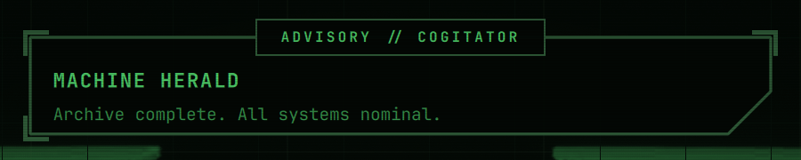](machine-herald.webp)

[Back to the project README](../../../README.md)
